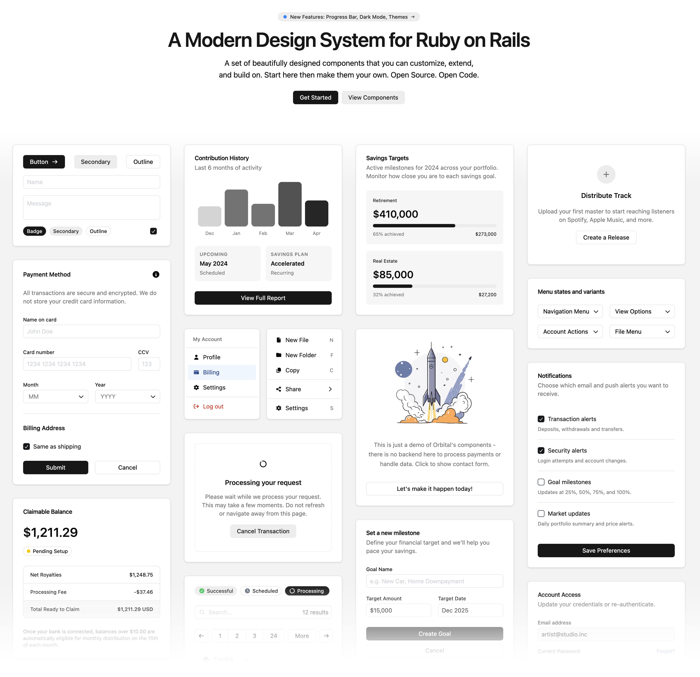

# Orbital



A modern design system and component library for Ruby on Rails, built with [ViewComponent](https://viewcomponent.org/), the [ORB Template Language](https://github.com/kuyio/orb_template) and [Tailwind CSS v4](https://tailwindcss.com/). Ship polished interfaces without leaving Rails.

- **Themable:** customize colors, typography and spacing with CSS variables
- **Dark mode:** built in, using a class toggle
- **Accessible:** components follow accessibility best practices

## Installation

Add the gem to your application's Gemfile:

```bash
bundle add orbital_ui
```

The gem is named `orbital_ui` because the `Orbital` gem on rubygems.org is an unrelated project.

Orbital requires Ruby 3.4 or newer and Rails 7.1 or newer.

To use Orbital components, you must add `OrbitalUi` to `ORB.namespaces` in an initializer, even if your own views only use ERB:

```ruby
# config/initializers/orb.rb
ORB.namespaces += %w[OrbitalUi]
```

Orbital's own templates use this setting to find each other. Without it, components such as `Alert`, `Dialog`, `Select` and `Spinner` raise a `NameError`.

## Usage

Include Orbital's CSS and JavaScript in your layout:

```erb
<%= stylesheet_link_tag "orbital_ui/index" %>
<%= javascript_include_tag "orbital_ui/index", type: "module" %>
```

Then use components in your views:

```erb
<%= render OrbitalUi::Button.new(variant: :primary) do %>
  Click me
<% end %>
```

In ORB templates, use components as tags:

```orb
<Button variant="outline" class="w-full">Full Width</Button>
<Card class="border-primary">Highlighted Card</Card>
```

Every component accepts a `class` attribute for one-off adjustments.

## Components

### Layout & Structure
- **Accordion:** Collapsible content sections with keyboard navigation
- **Card:** Content containers with optional header and footer slots
- **Expander:** Flexible spacer for distributing space in flex layouts
- **Grid:** CSS Grid container with column and span control
- **Inline Stack:** Horizontal flex container with spacing and alignment
- **Separator:** Horizontal or vertical dividers between content sections
- **Stack:** Vertical flex container with spacing and alignment

### Navigation
- **Navigation Menu:** Responsive site navigation with mobile drawer
- **Dropdown:** Trigger/content pattern for menus and popovers
- **Menu:** Structured menu with items, labels, separators, and submenus

### Data Display
- **Avatar:** User avatars with initials or Gravatar integration
- **Badge:** Small status indicators and labels
- **Icon:** Inline SVG icons from Lucide and Font Awesome brands, with size variants
- **Image:** Asset pipeline image component
- **Kbd:** Keyboard shortcut display
- **Progress Bar:** Horizontal bar with value/max fill calculation
- **Spinner:** Loading indicators
- **Tooltip:** Contextual information on hover

### Typography
- **Heading:** Semantic headings with size scale (xs–4xl)
- **Text:** Body text with size, weight, tone, and alignment control
- **Prose:** Long-form content styling
- **Typography:** Display type for marketing pages

### Forms
- **Button:** Primary, secondary, outline, ghost, and destructive variants
- **Button Group:** Visually connected button sets
- **Check Box:** Toggle inputs with labels and help text
- **Select:** Custom dropdown select with search
- **Text Field:** Inputs and textareas with icons, prefix/suffix, and validation

### Feedback
- **Alert:** Contextual messages with tone variants
- **Dialog:** Modal dialogs with header, body, and footer
- **Confirmation Dialog:** Confirm/cancel pattern
- **Delete Dialog:** Destructive action confirmation

### Overlay
- **Modal:** Full-screen overlay container
- **Popcard:** Hover card previews
- **Popover:** Anchored floating content

## Theming

Orbital uses a semantic color system powered by CSS custom properties. Override any variable after Orbital's CSS, either in a separate stylesheet or in your main one:

```css
@import "orbital_ui/index.css";

:root {
  --primary: hotpink;
  --primary-foreground: white;
  --radius: 0.25rem;
}
```

Colors, surfaces and radii are defined in `app/assets/stylesheets/orbital_ui/theme.css`. The full set includes:

- **Surfaces:** `--background`, `--card`, `--popover`, `--muted`, `--accent`
- **Interactive:** `--primary`, `--secondary`, `--destructive`
- **Semantic tones:** `--tone-success`, `--tone-warning`, `--tone-danger`, `--tone-info`, `--tone-magic`
- **Borders & inputs:** `--border`, `--input`, `--ring`
- **Typography:** `--font-weight-normal`, `--font-weight-medium`, `--font-weight-semibold`, `--font-weight-bold`, `--text-body-*`, `--text-heading-*`
- **Shape:** `--radius`

See the [theming guide](https://github.com/kuyio/orbital_ui/blob/main/theming/README.md) and its [example theme](https://github.com/kuyio/orbital_ui/blob/main/theming/custom-theme.css).

### Dark Mode

Add the `dark` class to your `<html>` or `<body>` element. All theme variables swap automatically. To customize dark mode colors, override them under `.dark`.

### Host Application Responsibilities

Orbital **only styles** `.Orbital-*` components. Your application is responsible for page backgrounds and layouts, body text colors and fonts, global margins and padding, and any other styling. Orbital's shipped CSS doesn't provide general Tailwind utility classes for your own markup, so build those in your application's Tailwind setup.

## Development

The gem is at the repository root, and `test/dummy` is a Rails app that documents every component.

You'll need Ruby (see `.ruby-version`), [Bun](https://bun.sh/) and, for the full test run, [Trivy](https://trivy.dev/).

```bash
bin/setup   # Install dependencies and build the docs app's assets
bin/dev     # Run the docs app on http://localhost:3000, with asset watchers
```

`bin/dev` rebuilds the gem's committed assets in development mode, so run `make assets` before committing them.

| Command | What it does |
|---|---|
| `make test` | RuboCop, Minitest, Trivy, bundler-audit and Brakeman |
| `make test-rubies` | Minitest on every supported Ruby (needs rbenv) |
| `make build` | Builds the `.gem` |
| `make lint-js`, `make typecheck`, `make bun-audit` | Biome, TypeScript and npm dependency checks |
| `make assets`, `make assets-dummy`, `make icons` | Rebuild the gem's assets, the docs app's assets, or the icons |

To run the docs site in a container, see the `Dockerfile`.

## Contributing

Bug reports and pull requests are welcome on [GitHub](https://github.com/kuyio/orbital_ui). Everyone interacting in the project is expected to follow the [code of conduct](https://github.com/kuyio/orbital_ui/blob/main/CODE_OF_CONDUCT.md).

1. Fork the repository
2. Create a feature branch
3. Make your changes
4. Test with the docs app and `make test`
5. Submit a pull request

## License

Orbital is available as open source under the terms of the [MIT License](LICENSE).

### Third-party licenses

Orbital bundles icons from these projects. `lib/orbital_ui/icons.rb` lists the same notices.

**Lucide** is distributed under the ISC License:

```text
Copyright (c) 2026 Lucide Icons and Contributors

Permission to use, copy, modify, and/or distribute this software for any
purpose with or without fee is hereby granted, provided that the above
copyright notice and this permission notice appear in all copies.

THE SOFTWARE IS PROVIDED "AS IS" AND THE AUTHOR DISCLAIMS ALL WARRANTIES
WITH REGARD TO THIS SOFTWARE INCLUDING ALL IMPLIED WARRANTIES OF
MERCHANTABILITY AND FITNESS. IN NO EVENT SHALL THE AUTHOR BE LIABLE FOR
ANY SPECIAL, DIRECT, INDIRECT, OR CONSEQUENTIAL DAMAGES OR ANY DAMAGES
WHATSOEVER RESULTING FROM LOSS OF USE, DATA OR PROFITS, WHETHER IN AN
ACTION OF CONTRACT, NEGLIGENCE OR OTHER TORTIOUS ACTION, ARISING OUT OF
OR IN CONNECTION WITH THE USE OR PERFORMANCE OF THIS SOFTWARE.
```

**Feather:** some Lucide icons are derived from Feather, listed in `lib/orbital_ui/icons.rb`. Those icons are distributed under the MIT License:

```text
Copyright (c) 2013-present Cole Bemis

Permission is hereby granted, free of charge, to any person obtaining a copy
of this software and associated documentation files (the "Software"), to deal
in the Software without restriction, including without limitation the rights
to use, copy, modify, merge, publish, distribute, sublicense, and/or sell
copies of the Software, and to permit persons to whom the Software is
furnished to do so, subject to the following conditions:

The above copyright notice and this permission notice shall be included in all
copies or substantial portions of the Software.

THE SOFTWARE IS PROVIDED "AS IS", WITHOUT WARRANTY OF ANY KIND, EXPRESS OR
IMPLIED, INCLUDING BUT NOT LIMITED TO THE WARRANTIES OF MERCHANTABILITY,
FITNESS FOR A PARTICULAR PURPOSE AND NONINFRINGEMENT. IN NO EVENT SHALL THE
AUTHORS OR COPYRIGHT HOLDERS BE LIABLE FOR ANY CLAIM, DAMAGES OR OTHER
LIABILITY, WHETHER IN AN ACTION OF CONTRACT, TORT OR OTHERWISE, ARISING FROM,
OUT OF OR IN CONNECTION WITH THE SOFTWARE OR THE USE OR OTHER DEALINGS IN THE
SOFTWARE.
```

**Font Awesome Free** brand icons by Fonticons, Inc. are licensed under [CC BY 4.0](https://fontawesome.com/license/free). Each icon in `lib/orbital_ui/icons.rb` keeps its attribution comment.
